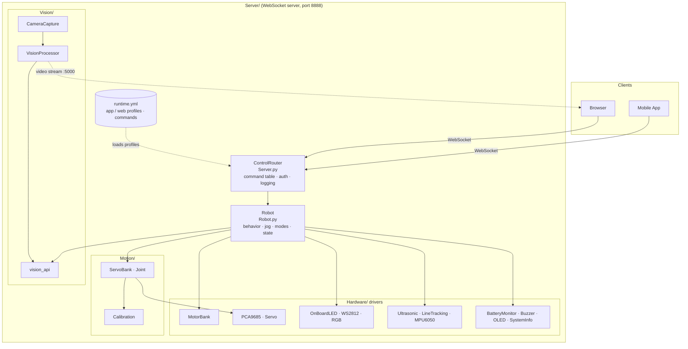

# Adeept PiCar-Pro Kit for Raspberry Pi
Adeept PiCar-Pro is an open source intelligent robotics product for artificial intelligence, robotics enthusiasts and students. This product is based on the Raspberry Pi motherboard using the python language and is compatible with the following Raspberry Pi models: 3B,3B+,4B,5, etc.


## Quick Start

### 1. Download
```bash
sudo git clone https://github.com/adeept/Adeept_PiCar-Pro.git
```

### 2. Install dependencies and set up the service
From the repository root on the Raspberry Pi, run the installer with `sudo`. It enables SPI/I2C, installs the required apt and Python packages, downloads the dependent repositories, and registers the auto-start services:

```bash
cd ~/Adeept_PiCar-Pro
sudo python3 install.py
```

The installer reboots the Pi when finished. After reboot, the robot server starts automatically.


### 3. Choose the control mode
The server supports two profiles, configured in `Server/runtime.yml`:

| Mode | Description |
|------|-------------|
| `app` | Mobile app control |
| `web` | Browser control |

Set the default mode in `Server/runtime.yml`:

```yaml
server:
  mode: app      # app or web
```

You can also override it on the command line:

```bash
cd ~
sudo killall python3
sudo python3 Adeept_PiCar-Pro/Server/Server.py --mode web
```

### 4. Connect and control
- **App mode**: open the Adeept mobile app and connect to the Pi over the robot's IP address.
- **Web mode**: open a browser and visit `http://<pi-ip>:5000`.

The control server listens on port `8888` by default; the camera stream is served on port `5000`. Both can be changed in `Server/runtime.yml`.

Press `Ctrl+C` to stop the server.


## Architecture

The backend is a single WebSocket server split into three layers: routing, robot behavior, and hardware/vision drivers. `Server.py` only parses commands and dispatches them; `Robot.py` owns the hardware and behavior; drivers live under `Hardware/`, `Motion/` and `Vision/`.



### Layer responsibilities

| Layer | Module | Responsibility |
|-------|--------|----------------|
| Routing | `Server/Server.py` | WebSocket entry, authentication, command-table lookup and dispatch to a Robot method; app/web profiles loaded from `runtime.yml`. |
| Behavior | `Server/Robot.py` | Hardware composition, driving/steering, arm jog press-and-hold, automatic modes, sensors polling and status display. |
| Hardware | `Server/Hardware/` | Per-device drivers: motors, servos/PCA9685, LEDs, ultrasonic, line tracking, IMU, battery, buzzer, OLED, system info. |
| Motion | `Server/Motion/` | Servo bank, per-joint state and angle calibration (`neutral / direction / min / max`). |
| Vision | `Server/Vision/` | Camera capture, frame processing (line tracking, color detection) and the API the Robot calls; streams frames to the web browser. |

The `app` and `web` command tables are kept separate under `server.modes` in `runtime.yml`, so each profile can be tuned independently.


## Resources Links

[RobotName]: Adeept PiCar-Pro \
[Item Code]: ADR019 \
[Official Raspberry Pi website]: https://www.raspberrypi.org/downloads/    \
[Official website]:  https://www.adeept.com/        


## Getting Support or Providing Advice

Adeept provides free and responsive product and technical support, including but not limited to:   
* Product quality issues 
* Product use and build issues
* Questions regarding the technology employed in our products for learning and education
* Your input and opinions are always welcome

We also encourage your ideas and suggestions for new products and product improvements
For any of the above, you may send us an email to:     \
Technical support: support@adeept.com      \
Customer Service: service@adeept.com


## About Adeept

Adeept was founded in 2015 and is a company dedicated to open source hardware and STEM education services. The Adeept technical team continuously develops new technologies, uses excellent products as technology and service carriers, and provides comprehensive tutorials and after-sales technical support to help users combine learning with entertainment. The main products include various learning kits and robots for Arduino, Raspberry Pi, ESP32 and BBC micro:bit.    \
Adeept is committed to assist customers in their education of robotics, programming and electronic circuits so that they may transform their creative ideas into prototypes and new and innovative products. To this end, our services include but are not limited to:   
* Educational and Entertaining Project Kits for Robots, Smart Cars and Drones
* Educational Kits to Learn Robotic Software Systems for Arduino, Raspberry Pi and micro: bit
* Electronic Component Assortments, Electronic Modules and Specialized Tools
* Product Development and Customization Services


## Copyright

Adeept brand and logo are copyright of Shenzhen Adeept Technology Co., Ltd. and cannot be used without written permission.
